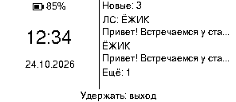

# Meshtastic InkHUD RU — Heltec Vision Master E290

Русский интерфейс и кириллица для **Heltec Vision Master E290**, плюс заставка с часами и списком непрочитанных сообщений. Основано на официальном **Meshtastic 2.7.26.54e0d8d Beta**. Неофициальная модификация; проект не связан с Heltec и командой Meshtastic.

**[Скачать готовую прошивку → Releases](https://github.com/AndreyAbakumov/meshtastic-inkhud-ru-e290/releases/latest)** · **[Инструкция по прошивке](docs/FLASHING.md)** · **[Сборка из исходников](docs/BUILDING.md)**

## Возможности

- 229 переводов: меню, подсказки, статусы, уведомления и названия экранов.
- Русские сообщения, имена и Ё/ё; строгий UTF-8, исправленные переносы и усечение текста.
- **Экран → Заставка**: часы, дата и заряд АКБ слева, непрочитанные справа. Включение вручную или через 1/5/15 минут бездействия, по умолчанию выключено.
- Выход из заставки — удержанием основной кнопки. Обычные нажатия обеих кнопок не переключают окна.
- **Индикатор АКБ на заставке:** значок батареи и процент заряда из PowerStatus; если данных нет — `--%`. Обновляется вместе с минутным кадром.
- **Полная очистка E-Ink каждую минуту**, чтобы старые цифры не накладывались на новые. Обновление сопровождается коротким миганием.

Это программное превью реального метода рисования, а не фотография панели.

## Быстрый старт

1. Скачайте **`meshtastic-e290-inkhud-ru.zip`** из последнего релиза и распакуйте.
2. Сохраните настройки, ключи и резервную копию памяти. Полная установка стирает прежние данные.
3. Следуйте **[FLASHING.md](docs/FLASHING.md)**: там отдельные процедуры обновления и установки с нуля, адреса записи и команды для macOS/Linux/Windows.
4. После чистой установки задайте регион, каналы и часовой пояс; подключите приложение для синхронизации времени.
5. Откройте **Экран → Заставка**.

Рекомендуемый способ — **esptool 4.11.0**. После записи через USB-загрузчик ESP32-S3 приложение может остаться в `waiting for download`; в комплекте есть **`start_firmware.py`**, который запускает его без стирания памяти. Инструкция также описывает проблему занятого браузером порта.

## Выбор файлов

| Файл | Назначение | Адрес |
|---|---|---|
| `meshtastic-e290-inkhud-ru.bin` | Обновление приложения | `0x10000` |
| `meshtastic-e290-inkhud-ru.factory.bin` | Загрузчик, таблица разделов, boot_app0, приложение | `0x0` |
| `mt-esp32s3-ota.bin` | Вспомогательный OTA из официального релиза | `0x340000` |
| `littlefs-e290-inkhud-ru.bin` | Файловая система для чистой установки | `0x670000` |

**Factory-образ не содержит OTA и LittleFS:** для чистой установки нужны все три файла. Не записывайте обычный BIN в `0x0`. Контрольные суммы находятся внутри ZIP в `dist/SHA256SUMS.txt`, SHA-256 самого ZIP — отдельный файл релиза.

Только **E290 с ESP32-S3 и штатной распиновкой**. Используется таблица разделов на первые 8 MB Flash; проверенное устройство имеет физическую Flash 16 MB. E213/T190 и другие платы не поддерживаются этим комплектом.

## Непрочитанные сообщения

Очередь хранит **последние 20 входящих непрочитанных сообщений в RAM**; при переполнении старейшие удаляются. После перезагрузки очередь очищается, а таймер заставки сохраняется. Личные пакеты другим узлам и недавние дубликаты исключаются.

Показ на заставке не отмечает сообщение прочитанным. Запись удаляется при отображении соответствующего сообщения на обычном экране сообщений; в истории канала — если тело целиком помещается в видимую область. В меню есть **«Прочитать всё»** для очистки очереди без удаления штатной истории. Это блокировка кнопок без PIN: текст сообщений остаётся виден.

## Проверено

- C++ host-тесты с ASan/UBSan: UTF-8, 50 000 случайных строк, метрики шрифтов, переносы, усечение, обе ориентации.
- Реальные методы меню, подсказок, заставки, таймера и очереди с заглушками сервисов. Отдельный тест повторного рисования `11:59 → 12:00` проверяет удаление старых пикселей.
- Чистая установка на реальный E290, проверка хешей записи, запуск, ответ USB API с моделью 68 и работа дисплея. Последнее исправление минутного обновления также записано на устройство.

Дальность и обмен LoRa/BLE/Wi-Fi, долговременная стабильность и энергопотребление требуют дальнейшей проверки. Строка версии внутри устройства остаётся `2.7.26.54e0d8d`; отличайте эту сборку по SHA-256 и релизу проекта. Переход с 2.8 на 2.7 — понижение версии; для него предусмотрена чистая установка с резервным копированием.

## Исходники и лицензии

[Полный патч](patches/e290-inkhud-ru.patch) применяется к commit `54e0d8d0ab2ff56b3a9ce967e53f79e49af560fb` официального [meshtastic/firmware](https://github.com/meshtastic/firmware). Полный снимок изменённых исходников и подмодулей доступен в каждом релизе. [Инструкция сборки](docs/BUILDING.md), [сведения о сборке](docs/BUILD_INFO.md), [изменения](docs/CHANGELOG.md).

GPL-3.0 для прошивки и изменений; GNU FreeFont — GPL-3.0-or-later с исключением для встраивания. Уведомления GFX_Root/Adafruit и FreeFont сохранены в [licenses/](licenses/).
